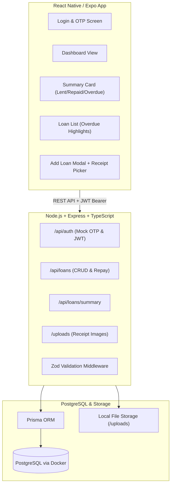

# MiniLedger — Full-Stack Assessment Implementation Plan

## 1. Project Overview & Architecture

**MiniLedger** is a personal debt and loan tracker designed to record and manage money lent to friends, monitor repayment statuses, and flag overdue amounts.



---

## 2. Technology Stack & Design Decisions

| Layer | Chosen Technology | Rationale |
|---|---|---|
| **Backend Runtime** | Node.js (v20+) with TypeScript | Required by prompt; provides full type safety across requests/models. |
| **Backend Framework**| Express.js | Lightweight, transparent routing, minimal overhead, rapid setup. |
| **Database & ORM** | PostgreSQL + Prisma ORM | Prisma offers type-safe database queries, auto-generated migrations, and Prisma Studio for inspection. |
| **Containerization** | Docker Compose (`docker-compose.yml`) | Enables single-command database provisioning (`docker compose up -d`) for zero-friction evaluation. |
| **Validation** | Zod | Robust schema validation with typed error messages. |
| **Testing** | Jest + Supertest | Unit & integration tests for authentication, loan transitions, and summary financial calculations. |
| **Mobile App** | React Native via Expo (TypeScript) | High developer velocity, cross-platform (iOS, Android, plus Web preview for easy grading without emulators). |
| **Mobile Navigation**| React Navigation (Native Stack) or Expo Router | Smooth screen transitions between Login and Dashboard. |
| **Receipt Handling** | `multer` (Backend) + `expo-image-picker` (Frontend) | Standard multipart/form-data upload stored locally and served statically. |

---

## 3. Database Schema Design (Prisma)

```prisma
datasource db {
  provider = "postgresql"
  url      = env("DATABASE_URL")
}

generator client {
  provider = "prisma-client-js"
}

model User {
  id        String   @id @default(uuid())
  phone     String   @unique
  createdAt DateTime @default(now())
  updatedAt DateTime @updatedAt
  loans     Loan[]
  otps      Otp[]
}

model Otp {
  id        String   @id @default(uuid())
  phone     String
  code      String
  expiresAt DateTime
  verified  Boolean  @default(false)
  createdAt DateTime @default(now())
}

enum LoanStatus {
  PENDING
  REPAID
}

model Loan {
  id           String     @id @default(uuid())
  userId       String
  user         User       @relation(fields: [userId], references: [id], onDelete: Cascade)
  friendName   String
  amount       Decimal    @db.Decimal(12, 2)
  dueDate      DateTime
  status       LoanStatus @default(PENDING)
  repaidAt     DateTime?
  receiptUrl   String?
  notes        String?
  createdAt    DateTime   @default(now())
  updatedAt    DateTime   @updatedAt

  @@index([userId])
  @@index([dueDate, status])
}
```

---

## 4. API Endpoints Specification

### 4.1 Authentication
- **`POST /api/auth/send-otp`**
  - **Body**: `{ "phone": "+1234567890" }`
  - **Action**: Generates a 6-digit mock OTP, saves with 5-minute TTL, and logs clearly to server console:
    ```
    ┌──────────────────────────────────────────────────┐
    │ [MOCK OTP] Phone: +1234567890 | Code: 482910     │
    └──────────────────────────────────────────────────┘
    ```
  - **Response**: `{ "success": true, "message": "OTP sent to server logs" }`

- **`POST /api/auth/verify-otp`**
  - **Body**: `{ "phone": "+1234567890", "code": "482910" }`
  - **Action**: Validates code, marks OTP as used, upserts `User`, returns JWT.
  - **Response**: `{ "token": "jwt_token...", "user": { "id": "...", "phone": "..." } }`

### 4.2 Loans Management (Protected with `Bearer <token>`)
- **`POST /api/loans`** (Supports `multipart/form-data` or JSON)
  - **Body**:
    - `friendName` (string, required)
    - `amount` (number > 0, required)
    - `dueDate` (ISO 8601 date, required)
    - `receipt` (image file, optional)
    - `notes` (string, optional)
  - **Response**: Newly created Loan object (201 Created).

- **`GET /api/loans`**
  - **Query Params**: `status=PENDING|REPAID|OVERDUE`, `sort=dueDate:asc|desc`
  - **Response**: Array of loans belonging to authenticated user with computed `isOverdue` flag.

- **`PATCH /api/loans/:id/repay`**
  - **Action**: Verifies ownership, flips `status` to `REPAID`, records `repaidAt = new Date()`.
  - **Response**: Updated loan object.

### 4.3 Summary Endpoint (Protected)
- **`GET /api/loans/summary`**
  - **Calculation Logic**:
    - `totalLent`: Sum of all loans for this user.
    - `totalRepaid`: Sum of loans where `status = REPAID`.
    - `totalPending`: Sum of loans where `status = PENDING`.
    - `overdueAmount`: Sum of loans where `status = PENDING` AND `dueDate < NOW()`.
    - `counts`: Breakdown `{ total: 10, repaid: 4, pending: 6, overdue: 2 }`.
  - **Response**:
    ```json
    {
      "totalLent": 15400.00,
      "totalRepaid": 6000.00,
      "totalPending": 9400.00,
      "overdueAmount": 3200.00,
      "counts": {
        "total": 5,
        "repaid": 2,
        "pending": 3,
        "overdue": 1
      }
    }
    ```

---

## 5. React Native App Architecture

```
mobile/
├── App.tsx                   # Root component with providers (Auth, Theme)
├── src/
│   ├── api/
│   │   ├── client.ts         # Axios instance with JWT interceptor & base URL
│   │   └── loans.ts          # Auth, Loans & Summary API calls
│   ├── context/
│   │   └── AuthContext.tsx   # Auth state (token, user, login, logout)
│   ├── screens/
│   │   ├── LoginScreen.tsx   # Phone + Mock OTP verification
│   │   └── HomeScreen.tsx    # Dashboard with Summary Card & Loan List
│   ├── components/
│   │   ├── SummaryCard.tsx   # Sleek metric cards (Lent, Repaid, Overdue)
│   │   ├── LoanCard.tsx      # Entry with status badges & "Mark Repaid" action
│   │   ├── AddLoanModal.tsx  # Form with DatePicker and Photo picker
│   │   ├── ReceiptViewer.tsx # Image preview modal
│   │   └── FilterTabs.tsx    # All / Pending / Overdue / Repaid filter
│   └── utils/
│       ├── formatters.ts     # Currency and date formatters
│       └── constants.ts      # Colors, typography, spacing tokens
```

### Screen Flow & UX Highlights:
1. **Login Screen**:
   - Modern phone input with country code.
   - "Send OTP" triggers animation to reveal 6-digit code boxes.
   - In-app helper alert: *"Assessment mode: Check server terminal or use default mock code"*.
2. **Dashboard / Home Screen**:
   - **Top Summary Card**: Modern dark/gradient card showing:
     - Total Lent (Indigo accent)
     - Repaid (Emerald accent)
     - Overdue (Rose/Red accent)
   - **Filter Segment Control**: Quick switch between *All*, *Active*, *Overdue*, and *Repaid*.
   - **Loan Cards**:
     - Friend name with avatar initials.
     - Formatted currency amount.
     - Due date with relative badge (e.g., *"Due in 3 days"* or *"Overdue by 5 days"* with red background & warning icon).
     - Thumbnail icon if receipt attached (tappable to view full-screen).
     - 1-tap **"Mark as Repaid"** button (swaps to a green checkmark).
   - **Floating Action Button (FAB) or Header "+" Button**: Opens bottom sheet / modal to add a new loan.

---

## 6. Implementation Phases & Milestones

### Phase 1: Repository & Backend Setup
1. Initialize monorepo or standard folder structure (`backend/` and `mobile/`).
2. Set up `docker-compose.yml` for PostgreSQL.
3. Configure TypeScript, Express, Prisma ORM, CORS, and logging.
4. Run initial database migration.

### Phase 2: Core Backend Logic & Testing
1. Implement Mock OTP service with terminal printing.
2. Implement JWT authentication and auth guard middleware.
3. Implement Loan CRUD, status toggling, and Zod schema validation.
4. Implement `/api/loans/summary` financial calculations.
5. Set up file upload middleware (`multer`) for receipt images.
6. Write automated tests using Jest and Supertest for core API endpoints and calculations.

### Phase 3: Mobile App Development (Expo + TypeScript)
1. Initialize Expo TypeScript app.
2. Build Design System tokens (clean dark/light aesthetic, typography, cards).
3. Implement `AuthContext` with AsyncStorage for token persistence.
4. Build `LoginScreen` (phone entry -> OTP input -> token storage).
5. Build `HomeScreen`:
   - `SummaryCard` connected to `/api/loans/summary`.
   - `LoanList` with overdue styling.
   - `AddLoanModal` with date picker and receipt photo picker.
   - Repayment toggle with optimistic UI update.

### Phase 4: Polish, Edge Cases & Documentation
1. Add pull-to-refresh and skeleton loaders.
2. Seed script (`npm run seed`) with realistic sample loans (some repaid, some upcoming, some overdue).
3. Write production-ready `README.md` with:
   - System prerequisites.
   - Step-by-step setup commands.
   - API documentation table.
   - Docker commands.
4. Prepare the 2–3 minute video recording script.

---

## 7. Submission Checklist

- [ ] **GitHub Repository**:
  - [ ] Clean folder structure (`/backend`, `/mobile`).
  - [ ] Fully documented `README.md` with run instructions.
  - [ ] `.env.example` files for backend and mobile.
  - [ ] Database seed script for rapid reviewer testing.
- [ ] **2–3 Minute Video Walkthrough**:
  - [ ] Part 1: Terminal running backend showing mock OTP output.
  - [ ] Part 2: Mobile app login using the logged OTP.
  - [ ] Part 3: Dashboard overview with Summary Card (Total Lent, Repaid, Overdue).
  - [ ] Part 4: Adding a new loan with due date and receipt image.
  - [ ] Part 5: Overdue item highlighting in red.
  - [ ] Part 6: Marking a loan as repaid and observing summary card update in real-time.
  - [ ] Part 7: Running automated test suite (`npm test`).
