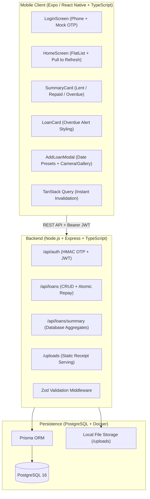

# MiniLedger 💳

A full-stack, fintech-grade mobile application to track money lent to friends, monitor repayments, and highlight overdue balances.

Built as an assessment solution with **Node.js, TypeScript, PostgreSQL, and Prisma ORM** on the backend, and **React Native via Expo (TypeScript)** on the mobile client.

---

## 📸 Key Features

- **Phone Number Login with Mock OTP**: Secure mock authentication where 6-digit codes are generated via `crypto.randomInt`, hashed using HMAC-SHA256, rate-limited, and printed directly to the backend terminal logs.
- **Dynamic Ledger Summary**: Live summary card displaying **Total Lent**, **Total Repaid**, and **Overdue Amount** with instant query cache updates.
- **Overdue Highlighting**: Clear business logic (`status = PENDING AND dueDate < today`) highlighting overdue entries in prominent red alert cards with day counters.
- **One-Tap Repayment**: Atomic status transition (`updateMany`) updating repayment timestamps, preventing race conditions, and correctly handling 404 vs 409 conflict states.
- **Receipt Photo Attachment**: Multipart upload support using `multer` on the backend and `expo-image-picker` on mobile, with an in-app fullscreen viewer.
- **Filter Tabs**: Instant filtering by *All*, *Pending*, *Overdue*, and *Repaid* with live count indicators.
- **Automated Test Suite**: 26 unit and integration tests (Jest + Supertest) covering domain rules, edge cases, date boundaries, and financial arithmetic.

---

## 🛠️ Tech Stack & Architecture



| Layer | Technologies | Key Decisions |
|---|---|---|
| **Backend** | Node 20+, Express, TypeScript, Zod, JWT | Strict schema validation, fast-fail environment checks, uniform error shapes. |
| **Database & ORM** | PostgreSQL 16 (Docker), Prisma ORM | Minor units integer storage (`amountMinor`), date-only `@db.Date` columns. |
| **Mobile App** | Expo (React Native + TypeScript), TanStack Query | Cross-platform, SecureStore JWT persistence, native `fetch` for multipart uploads. |
| **Testing** | Jest, ts-jest, Supertest | Isolated `miniledger_test` database, injected time clock for deterministic tests. |

---

## 🚀 Quick Start Guide

### 1. Prerequisites
- **Node.js**: v20 or higher (`node -v`)
- **Docker & Docker Compose**: For PostgreSQL (`docker compose version`)
- **Expo Go App** (on iOS/Android device) or an **Android/iOS emulator**

---

### 2. Clone & Start Database
```bash
# Clone the repository
git clone https://github.com/AgrShubham/MiniLedger.git
cd MiniLedger

# Start PostgreSQL (automatically provisions dev and test databases)
docker compose up -d
```

---

### 3. Setup & Run Backend
```bash
cd backend

# Install dependencies
npm install

# Apply database migrations
npx prisma migrate dev

# Seed database with realistic demo loans (repaid, pending, and overdue)
npm run seed

# Start development server
npm run dev
```

The server will start at `http://0.0.0.0:4000`. You will see the server banner in your terminal:
```
┌────────────────────────────────────────────────────────────┐
│                  MiniLedger Backend API                    │
│                                                            │
│  Status:   RUNNING                                         │
│  Host:     http://0.0.0.0:4000                             │
│  Health:   http://localhost:4000/health                   │
└────────────────────────────────────────────────────────────┘
```

---

### 4. Setup & Run Mobile App
Open a new terminal window:
```bash
cd MiniLedger/mobile

# Install dependencies
npm install

# Start Expo dev server
npm start
```
- **Physical Device**: Scan the QR code using the **Expo Go** app (Android) or Camera app (iOS).
- **Android Emulator**: Press `a` in the terminal.
- **iOS Simulator**: Press `i` in the terminal.

---

## 🌐 Mobile Networking Configuration

Configure `mobile/.env` with your API address based on your setup:

| Environment | `EXPO_PUBLIC_API_URL` setting | Notes |
|---|---|---|
| **Physical Phone (Expo Go)** | `http://<YOUR_LAN_IP>:4000` *(e.g. `http://192.168.1.12:4000`)* | Phone and PC must be on the same Wi-Fi. |
| **Android Emulator** | `http://10.0.2.2:4000` | Standard Android emulator alias to host machine. |
| **iOS Simulator** | `http://localhost:4000` | Simulator shares the host network interface. |

---

## 🔑 How to Log In (Mock OTP Flow)

1. Open the app on your phone or emulator.
2. The login screen defaults to the pre-seeded demo phone: `+919999999999` (or enter any valid E.164 phone number).
3. Tap **"Send Mock OTP"**.
4. Check your **backend terminal logs**. You will see a prominent boxed banner:
   ```
   ┌────────────────────────────────────────────────────────────┐
   │ [MOCK OTP] Phone: +919999999999    | Code: 482910          │
   └────────────────────────────────────────────────────────────┘
   ```
5. Enter the 6-digit code in the app and tap **"Verify & Continue"**.
6. The app stores the JWT session in `expo-secure-store` and opens your dashboard with all seeded loans!

---

## 📖 Business Rules & Edge Cases Handled

### 1. Money Handling (Integer Minor Units)
- To prevent IEEE-754 binary floating-point rounding errors (e.g. `0.1 + 0.2 === 0.30000000000000004`), amounts are stored in PostgreSQL as integer minor units (`amountMinor`, paise/cents).
- Conversions happen in a central, fully tested [`money.ts`](./backend/src/lib/money.ts) utility.
- Aggregations are calculated using SQL database sums (`aggregate._sum`), not in JavaScript.

### 2. Timezones & Overdue Definition
- `dueDate` is stored as a date-only column (`@db.Date` in PostgreSQL) formatted as `YYYY-MM-DD` to prevent UTC timezone date-shifting bugs.
- **Overdue Invariant**: `status = PENDING AND dueDate < today`.
- A loan due *today* is **not** overdue.
- Repaid loans are **never** overdue.
- An injectable clock abstraction (`clock.ts`) ensures server-computed `isOverdue` flags and deterministic test runs.

### 3. Repayment Atomicity
- Repaying uses an atomic query:
  ```ts
  prisma.loan.updateMany({
    where: { id: loanId, userId, status: 'PENDING' },
    data: { status: 'REPAID', repaidAt: now },
  });
  ```
- If 0 rows were updated, the service distinguishes whether the loan belongs to another user (returns **404 Not Found**) or was already repaid (returns **409 Conflict** with code `ALREADY_REPAID`).

### 4. Receipt Photo Security
- Uploaded files are verified against a strict MIME allowlist (`image/jpeg`, `image/png`, `image/webp`) with a 5 MB limit.
- Files are saved with cryptographically random UUID filenames (`uuidv4()`). Original user filenames are discarded to prevent directory traversal attacks.

---

## 📡 API Reference

All `/api/loans*` endpoints require `Authorization: Bearer <token>`.

### Authentication
| Method | Endpoint | Description | Request Body |
|---|---|---|---|
| `POST` | `/api/auth/send-otp` | Generates 6-digit OTP, prints to logs | `{ "phone": "+919999999999" }` |
| `POST` | `/api/auth/verify-otp` | Verifies code, returns JWT | `{ "phone": "+919999999999", "code": "123456" }` |

### Loans & Summary
| Method | Endpoint | Description | Query / Body |
|---|---|---|---|
| `GET` | `/api/loans/summary` | Financial aggregates & counts | Returns `totalLent`, `totalRepaid`, `overdueAmount`, `counts` |
| `GET` | `/api/loans` | List loans with `isOverdue` | Optional query: `?status=ALL\|PENDING\|OVERDUE\|REPAID` |
| `POST` | `/api/loans` | Create loan (JSON or multipart) | `{ "friendName": "Aman", "amount": 1500, "dueDate": "2026-11-05" }` + optional `receipt` file |
| `PUT` | `/api/loans/:id` | Edit loan card details & receipt | Optional: `friendName`, `amount`, `dueDate`, `notes`, `receipt` file |
| `PATCH` | `/api/loans/:id/repay` | Mark loan as repaid | Path param: `id` (UUID) |

---

## 🧪 Automated Testing

The backend includes a comprehensive test suite executed against an isolated `miniledger_test` database:

```bash
cd backend
npm test
```

### Test Coverage Highlights (29 automated tests):
- **`money.test.ts`**: Conversion between minor and major units, rounding boundaries, float edge cases, validation of decimal places.
- **`auth.test.ts`**: OTP generation, HMAC verification, attempt throttling (max 5), expiration logic (5-min TTL), single-use consumption, and JWT authentication guard.
- **`loans.test.ts`**: Loan creation with/without receipt images, loan updates (`PUT /api/loans/:id`), overdue boundary checks (`today` vs `yesterday`), user isolation (user A cannot view, edit, or repay user B's loans), atomic repayment transitions (409 on duplicate repay), and summary calculation math.

---

## 🎥 Video Recording Walkthrough Guide (Target: 2:45)

When recording your demonstration video (Loom or Google Drive), follow this proven outline:

1. **0:00 – 0:20 (Intro & Backend Running)**:
   - Show your split screen: terminal running `npm run dev` and Docker running PostgreSQL.
2. **0:20 – 0:50 (Mock OTP Login)**:
   - On the mobile app, tap **"Send Mock OTP"**.
   - Point to the terminal showing the boxed `[MOCK OTP]` log.
   - Enter the code in the app to land on the dashboard.
3. **0:50 – 1:20 (Dashboard & Summary Card)**:
   - Explain the top Summary Card (**Total Lent**, **Total Repaid**, and **Overdue Amount**).
   - Show the seeded entries and notice how overdue loans are highlighted in red alert cards.
4. **1:20 – 1:55 (Adding a Loan with Receipt)**:
   - Tap **"+ Add"**, enter a friend's name, amount, select a due date preset, and attach a receipt photo.
   - Submit and show the new entry appear instantly in the list with receipt badge. Tap to view the receipt in fullscreen.
5. **1:55 – 2:20 (Instant Repayment Update)**:
   - Tap **"Mark Repaid"** on an active loan.
   - Point out how the top Summary Card updates immediately (Total Repaid goes up, Overdue decreases).
6. **2:20 – 2:45 (Automated Tests & Wrap-Up)**:
   - Switch to terminal, run `npm test`, and show all 26 test suites passing.

---

## 🔭 Trade-offs & Production Considerations

In accordance with good engineering judgment, several conscious trade-offs were made for this assessment:

1. **Mock OTP vs SMS Provider**: For deterministic grading and zero cost, OTPs are printed to terminal logs with HMAC storage and attempt limiting. In production, this service would integrate with Twilio, AWS SNS, or Firebase Auth.
2. **Local Uploads vs S3 / Cloud Storage**: Receipt images are stored in a volume-mounted `/uploads` folder with UUID filenames. In a high-traffic production app, uploads would be sent to AWS S3 / Cloudflare R2 using pre-signed upload URLs.
3. **Pagination**: Loans are currently returned as an unpaginated array suitable for personal ledger scale. For accounts with thousands of entries, cursor-based pagination would be added.
4. **Offline Sync**: The app currently uses TanStack Query with optimistic invalidation. For field/travel use, SQLite / WatermelonDB with bi-directional syncing could be layered on.

---

## 📄 License
MIT
